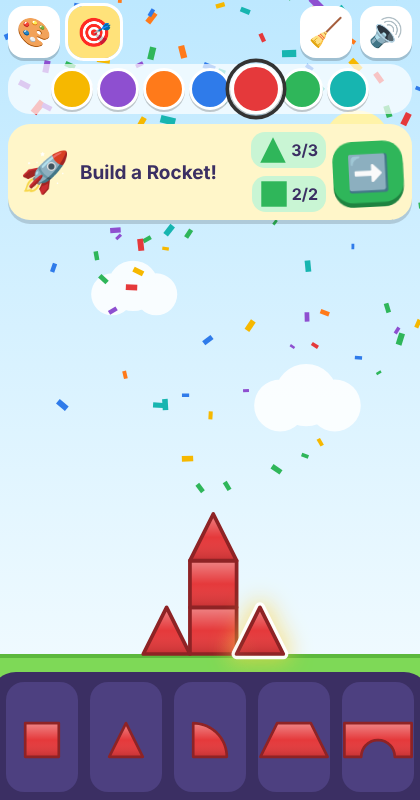
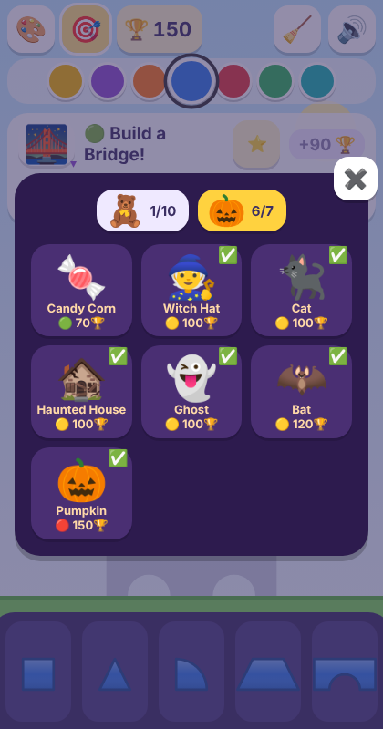
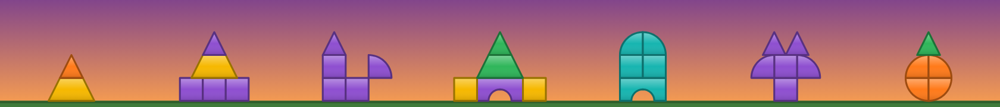
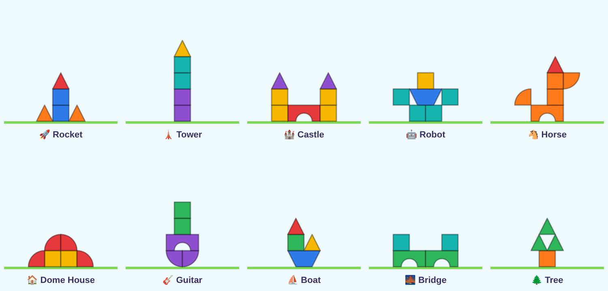

# 🧲 Magnet Blocks

A browser game for toddlers and young children, based on a box of chunky magnetic
stacking blocks. Drag shapes out of the tray. They click together like magnets.
Build anything you like, or take on themed challenges: the 10 creations pictured on the box,
plus a 🎃 Halloween pack.



It is made for tablets and phones first and works with a mouse too. Instead of words it
uses emoji, big touch targets and happy sounds. It has no timers or fail states. Finishing a
build earns 🏆 points, and that's the only score. Points unlock 🎁 gifts: new skies for free
build and new looks for the blocks.

## How to play

| Do this | What happens |
| --- | --- |
| Drag a shape out of the bottom tray | A new block (there's no limit) follows your finger |
| Drop it near another block | It snaps into place with a *click* and a glow 🧲 |
| Let go of a block in the air | It falls until it lands on the grass or on a block, then snaps there. Blocks held on by a magnet (hanging off the side of a tower, say) stay put |
| Drop a block onto another one | Blocks never overlap: it moves to the nearest free spot (on top, if that's as near) |
| Tap a block | It is selected, ready for a new colour |
| Tap the selected block again | It turns 90° |
| Tap the round ↺ button beside the selected block | It turns 90° again |
| Tap a color | It recolors the selected block and colors new blocks |
| Drag a block onto the 🗑️ bin (it appears top-right while you drag) | It's deleted; tap the bin straight away to get it back where it was. Anything it was holding up falls |
| Drop a block over the tray | It stays on the board |
| Tap a shape in the tray | A block drops into the middle of the play area. Tap again and the next one lands on top or beside it |
| Press and hold 🧹 | A ring fills around it, then everything is cleared. A quick tap does nothing. For a few seconds 🧹 turns into ↩️: tap it to get everything back |
| ❓ | Shows the welcome again: what challenges and free build are, and which packs there are (🎄 Christmas and 🚗 Vehicles are coming soon). **🏆 Prizes, backgrounds & points** opens the prizes shelf, and grown-ups will find **Reset progress…** at the bottom |
| 🎯 / 🎨 | Challenges / free build. The first visit opens on a welcome with a blank board; after that the game starts in challenges. 🎯 opens a grid where you choose a theme (🧸 Toy Box or 🎃 Halloween) and what to build. Tap the big emoji on the card to choose again; finished builds get a ✅ |
| 🏆 | Your score. It goes up every time you finish a build and is remembered on this device. Tap it for the 🎁 prizes shelf |
| 🔊 | Sound on/off |

**Challenges 🎯:** a card says what to build, for example "Build a Rocket! 🚀". It shows
each piece you need as a coloured shape with a count, such as 2 blue squares, 1 red
triangle and 2 orange triangles. Tapping a shape on the card picks its colour. A plain grey
**outline** of the build shows where it goes, without colours or piece lines. Pieces don't
jump into it, so you still work out which pieces fit where.

When your blocks **match the build**, with every piece in the right colour, in the right
place and turned the right way, there's confetti and a little tune. The build can stand
anywhere on the board. A ✅ on the card means all of that piece are in the right place,
and `1/2` means one of two is. Then a big green ➡️ button
appears just above the grass, showing the emoji of the next build. Blocks lying
elsewhere on the board don't count against you.

**Easy → hard 🟢🟡🔴:** each build gets a tier from how tricky it is: one point per piece,
two more per piece that has to be turned, and one more per extra kind of shape.

| Tier | Complexity |
| --- | --- |
| 🟢 easy | up to 6 |
| 🟡 medium | 7–10 |
| 🔴 hard | 11 and up |

Within each theme the builds are ordered easiest first. ➡️ follows that path to the next
build you haven't finished, so a child works up from the Bridge and the Tree to the Horse.
Nothing is locked, and you can still pick any build from the grid. The grid shows each
build's tier dot and the points it's worth.



**Score 🏆:** each finished build gives points. A "+N" flies from the card to the 🏆
counter, which counts up with a little *ding*:

| | Points |
| --- | --- |
| Each piece in the build | 10 |
| Tier | ×1 🟢, ×2 🟡, ×3 🔴 |
| First time you finish that build | +50 bonus |
| First time you finish every build in a theme | +200 bonus, with an encore of confetti |

So the Rocket (5 pieces, 🟢 easy) is worth 100 the first time and 50 after that. The Horse
(6 pieces, 🔴 hard) is worth 230 the first time and 180 after that. The card shows the points on offer before you start.
The score and the ✅ finished builds are saved in `localStorage`, so they survive a reload.

**Gifts 🎁:** the 🏆 score unlocks surprise gifts. A thin strip along the bottom of the 🏆
button fills towards the next one (a 🎁 peeks out near the end). No "points to go" number is shown, and free build never earns points.
When a win crosses a threshold, a wrapped 🎁 appears once the score has finished counting up.
Tap it to open it and see what's inside; it's switched on straight away. Two gifts at once come one after the other. A gift doesn't appear on the shelf until its celebration, and if it opens by itself after 6 seconds, it closes 5 seconds later.

| Score | Gift | What it is |
| ---: | --- | --- |
| 50 | ✨ Sparkly blocks | A block look: a few twinkling white highlights |
| 250 | 🌙 Night sky | A sky with twinkling stars and a moon |
| 600 | 🌊 Underwater | A sky with fish swimming by and bubbles |
| 1000 | 🫧 Bubble blocks | A block look: a glossy highlight |
| 1700 | 🚀 Space | A sky with a starfield and a ringed planet |
| 2900 | 👑 Crown + 🎃 Dusk sky | 👑 replaces 🏆, and the Halloween dusk becomes a sky you can choose |

Finishing every build once is worth **2,970 points** (Toy Box 1,730 including its pack bonus,
Halloween 1,240), so every gift can be had without replays. The lowest first-time build
score is 70, so the very first win always gives ✨. Replays still score. The unit tests check
both rules against the real builds (`maxFirstTimeScore()` in `geometry.js`), and each new pack
should add one gift above the current top.

Tap 🏆 (or **🏆 Prizes, backgrounds & points** in ❓) to open **Your prizes**. Its header shows the
score and the next total to aim for, for example "🏆 300 → 🎁 600", over a bar ("👑 3000" once
everything is found). Below it are a row of skies (☀️ sunny plus the unlocked ones) and a row of block
looks (plain plus the unlocked ones). Tap a picture to use it. A single wrapped 🎁 sits in the row the
next gift belongs to, showing its target (e.g. "600") with its own little bar. The gift overlay names
the gift for whoever is reading along.

**Where skies show:** the chosen sky shows in 🎨 free build and in the 🧸 Toy Box builds, and the caption
says so. A *themed* pack (`themed: true` in `PACKS`, such as 🎃 Halloween) always keeps its own scene.
Picking a sky during a themed-pack build makes 🎨 wiggle (or glow, with reduced motion) to show where
it will appear. Each sky has its own outline style so the build's outline stands out: grey on the sunny
sky, and a light fill with a solid white edge on the dark ones. Skies with light patches too (dusk, the sea)
add a dark halo outside the white. The smoke test measures at least 3:1 contrast on each.
Block looks show everywhere, but they only add highlights. A block's colour never changes, so challenges
still match. A red dot on 🏆 means there's a gift you haven't looked at yet.

**For grown-ups:** the bottom of the prizes shelf has a closed-by-default section, *For grown-ups: how 🏆
points work*. It explains the scoring and lists every gift with its points, ✓ for the ones found. Below the
list it says what's next, for example "Now: 300 🏆. Next gift at 600: 🌊 Underwater".

Gifts are saved in `localStorage` (`magnet-blocks-gifts`), but the score is the source of truth.
Everything the score has reached is unlocked again on load, so losing that key never loses a gift.
A player who already had points when gifts arrived gets them all quietly, with the dot, rather than a flood of celebrations.
**Reset progress…** in the ❓ panel erases the score, the ✅ finished builds and the gifts after a
written confirmation (*Keep everything* is the default). It keeps the free build. Erasing in the middle of a win also stops that win (its count-up, ➡️ and any gift still to come), and takes the finished build off the board.

**Themes 🎃:** choosing a 🎃 Halloween build turns the sky to dusk, with a big moon,
bats flitting past and pumpkins in the grass. The outline gets a light fill, a white edge and a dark halo
there, so it shows up against both the dark sky and the orange glow. The pack has 7 builds, all made from the
same box of blocks: Candy Corn 🍬, Witch Hat 🧙, Cat 🐈‍⬛, Haunted House 🏚️, Ghost 👻,
Bat 🦇 and Pumpkin 🎃.





Each build is a target layout in `geometry.js`, with the pack it belongs to (see `PACKS`).
Its piece counts and tier are worked out from that layout. No build needs more of a
shape than the real box contains. To add a theme, add an entry to `PACKS` and give
its builds that `pack` id.

## The block set

| Shape | In the box | Size (square = 1) |
| --- | --- | --- |
| Square | 5 | 1 × 1 |
| Triangle | 3 | isosceles, base 1, height 1 |
| Quarter circle | 4 | radius 1 |
| Arch | 2 | 2 × 1, semicircle (r = ½) cut from the bottom |
| Trapezoid | 1 | 2 wide at the bottom, 1 wide at the top, 1 tall |

Colors: gold, purple, orange, blue, red, green and teal.

## Running it

There's no build step and there are no runtime dependencies. Any static file server will do:

```sh
npm start            # node scripts/serve.js 8000 → http://localhost:8000/
# or: python3 -m http.server
```

**Deploying:** the site is hosted on Vercel. Pushes to `main` go to production and every
other branch or PR gets a preview URL. `vercel.json` runs the unit tests and then
`npm run build`, which copies the site into `_site/` and stamps the script URLs in
`index.html` with the commit hash (`game.js?v=…`), so browsers never mix a cached old
script with a new page. A failing unit test fails the deploy.

## Code layout

| File | What it does |
| --- | --- |
| `index.html` | Layout, top bar, palette and challenge card (CSS inline) |
| `game.js` | Canvas rendering, pointer input, WebAudio sounds, confetti and UI |
| `geometry.js` | **Pure** logic with no DOM: shapes, transforms, magnet/ground snapping, hit testing, connectivity and challenges. Works in Node and the browser (`window.MagnetGeometry`) |
| `tests/geometry.test.js` | Unit tests (`node:test`) |
| `tests/smoke.js` | Playwright smoke test that drags real pieces with the mouse |
| `scripts/serve.js` | Tiny static server used by `npm start` and the smoke test |

**World model:** world units with the square at 1×1, the ground at `y = 0` and +y pointing up.
A piece is `{ id, shape, color, x, y, rot }`, where `(x, y)` is the centre of its bounding
box and `rot` counts 90° turns. The view always fits about 9 units across and 7 above
the ground, so builds fit in portrait and landscape.

**Snapping:** each shape has snap points (its vertices, its edge midpoints, and points
one unit apart along the 2-wide edges). While you drag, the nearest pair of points
between the dragged piece and any other piece is found. If that pair is within 0.3
units, the piece moves so the two points meet. A snap that would push the piece below
the ground, or into another block, is skipped. In that case the piece rests on the ground
and can still slide sideways to meet a neighbour. Two pieces are *connected* when they share a point.

**No overlaps:** two blocks overlap when one digs more than 0.01 units into the other
(`overlaps()`, which tests points along each edge and on a grid inside). A block let go
inside another goes to the nearest free spot (`findFreeSpot()`, trying upwards first), then
snaps. A free build saved before this was added is pulled apart on load (`separate()`).

**Gravity with magnets:** after every drop, tray tap, turn and delete, `settle()` makes blocks
joined by their magnets act as one group. A group that isn't resting on the ground or on
another block falls straight down until it lands, then snaps to what it landed on.
A block hanging off the side by a magnet stays up, so every build stands as it is (the unit
tests check all of them). Positions change at once, and the blocks are drawn falling into
place, or not at all with reduced motion.

## Tests

```sh
npm run test:unit    # pure geometry and snapping tests, no browser
npm run test:e2e     # Playwright smoke test; uses the installed Chromium, never downloads it
SHOTS=out npm run test:e2e   # also saves screenshots to ./out
```

The smoke test checks ground snapping, sideways and stacked magnet snapping,
tap to select then tap again to rotate, the ↺ rotate button, choosing a build from the picker, recoloring, deleting with the bin (and not by dropping over the tray) and undoing it, a cancelled drag putting the block back, the press-and-hold broom and its undo, completing
the rocket challenge in the right colours (including fixing a wrong-coloured piece),
the outline (pieces aren't pulled into it), the score for a finished build and that it
survives a reload, ➡️ going to the next build on the path, the 🎃 theme and its pack bonus,
the free build surviving a challenge and a reload, no overlaps on a phone (tapping a tray shape again and again
stacks the blocks where you can see them, nothing is left floating, and dragging one block by touch moves only that block), and the landscape layout: every build's outline fits below the card at 375×667, 667×375 and 568×320, and the Tower is finished by dragging at 568×320.
It also checks the 🎁 gifts at 375×667, each in a fresh browser profile. These checks cover:
- the first win's single gift, shown only after the count-up
- two gifts from one win, shown in turn
- the prizes shelf: its title, the "→ 🎁 600" target, and the grown-ups section at its bottom (also opened from ❓)
- skies showing in 🧸 builds but not in themed packs, with the outline at 3:1 or better on each sky
- the shelf fitting without sideways scroll at 375×667 and 568×320
- gifts surviving a reload and a lost key
- quietly migrating an existing score
- reset and its confirmation, including erasing in the middle of a win
- the gift opening and closing by itself
- a gift staying off the shelf until its celebration, and surviving a reload during the count-up
- Tab staying inside the gift overlay, the shelf and the reset confirmation
- storage that throws (private mode)
- reduced motion
- the top bar gaining no button or height

It fails on any page error.

## Roadmap

- **Group drag:** drag a whole snapped stack at once.
- **3D-looking blocks:** give the pieces thickness and lighting, while building stays in the flat plane.
- **Save and share builds:** for example as a URL hash or a picture.
- **Gentle physics:** loose blocks already fall straight down (#37). Next: blocks sliding off a slope, or wobbling softly, never in a frustrating way.
